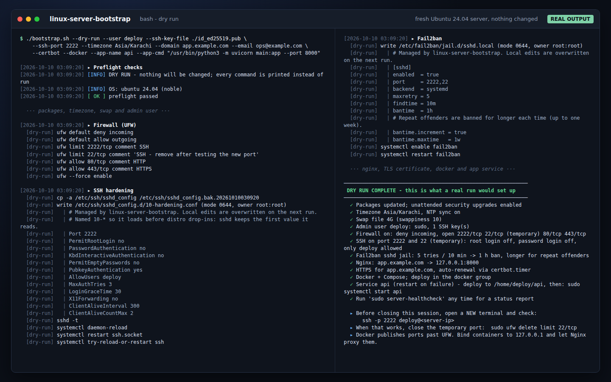
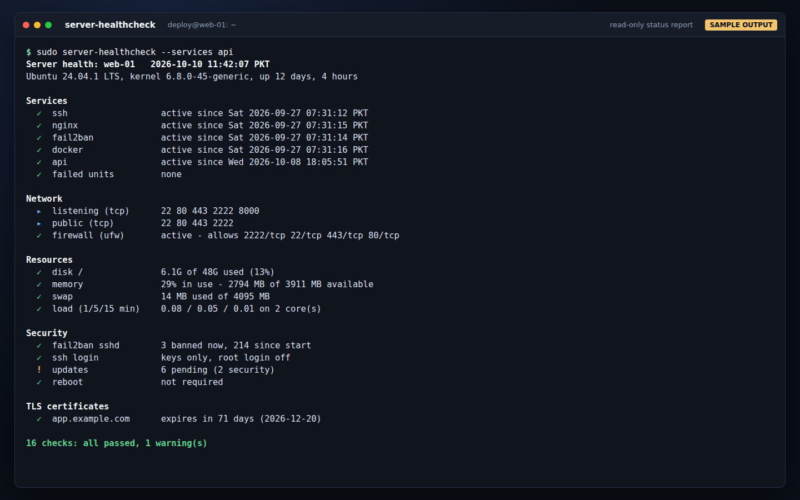
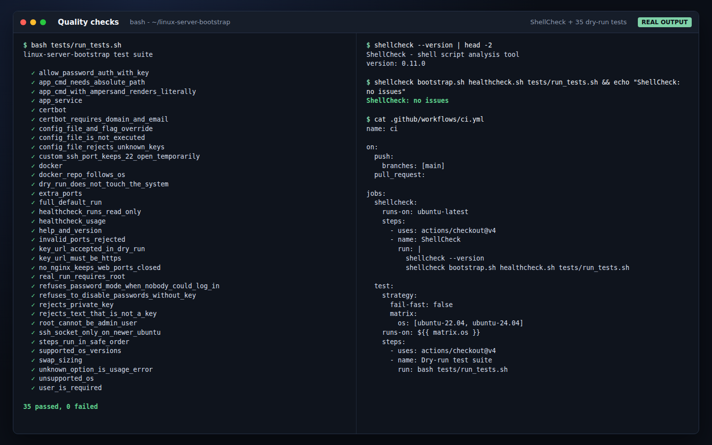

# linux-server-bootstrap

[](https://github.com/Ali83128/linux-server-bootstrap/actions/workflows/ci.yml)


**From a fresh VPS to a hardened, production-ready server in one command.**

`bootstrap.sh` sets up the things every new Ubuntu or Debian server needs before
it goes on the internet: an admin user with key-only SSH, a firewall, brute-force
protection, automatic security updates, swap, Nginx in front of your app, a free
TLS certificate, Docker, and a systemd service that restarts your app when it
crashes. It is idempotent (safe to run again), logs every step, and has a
`--dry-run` mode that shows exactly what it would do without touching anything.



## What it configures

| Step | What happens |
|---|---|
| Packages | `apt-get update && upgrade`, base tools, **unattended security upgrades** |
| Time | timezone of your choice, NTP sync on |
| Swap | swap file sized from RAM (2x up to 2 GB, 1x up to 8 GB, then 4 GB), `swappiness=10` |
| Admin user | new sudo user, SSH keys from a file or a URL such as `https://github.com/NAME.keys` |
| Firewall | UFW: deny all incoming, allow SSH (rate-limited), 80, 443 and any ports you list |
| SSH | root login off, password login off, only your admin user allowed, `sshd -t` validated before reload |
| Fail2ban | `sshd` jail with the systemd backend, longer bans for repeat offenders |
| Nginx | reverse proxy to your app port, WebSocket support, security headers, `nginx -t` before reload |
| HTTPS | optional Let's Encrypt certificate via Certbot, auto-renewal timer, HTTP to HTTPS redirect |
| Docker | optional Docker Engine + Compose plugin from Docker's official repository |
| App service | optional systemd unit: restart on failure, env file, basic sandboxing |
| Health check | installs `server-healthcheck`, a one-screen status report |

## Quick start

Preview first. A dry run needs no root and changes nothing:

```bash
git clone https://github.com/Ali83128/linux-server-bootstrap.git
cd linux-server-bootstrap
./bootstrap.sh --dry-run --user deploy --ssh-key-file ~/.ssh/id_ed25519.pub
```

Then run it for real on the server:

```bash
sudo ./bootstrap.sh --user deploy --ssh-key-url https://github.com/YOUR-GITHUB-NAME.keys
```

Without git, download and preview in one line:

```bash
curl -fsSL https://github.com/Ali83128/linux-server-bootstrap/archive/refs/heads/main.tar.gz | tar xz \
  && cd linux-server-bootstrap-main \
  && ./bootstrap.sh --dry-run --user deploy --ssh-key-url https://github.com/YOUR-GITHUB-NAME.keys
```

A typical web-app server, with HTTPS, Docker and a service for the app:

```bash
sudo ./bootstrap.sh \
  --user deploy --ssh-key-file ./id_ed25519.pub \
  --ssh-port 2222 --timezone Asia/Karachi \
  --domain app.example.com --email ops@example.com --certbot \
  --docker \
  --app-name api --app-cmd "/usr/bin/python3 -m uvicorn main:app --port 8000"
```

## Options

| Flag | Default | Description |
|---|---|---|
| `-u, --user NAME` | required | admin account to create (sudo, key-only SSH) |
| `-k, --ssh-key-file FILE` | | public key(s) to authorize |
| `-K, --ssh-key-url URL` | | download public keys over HTTPS, e.g. `https://github.com/NAME.keys` |
| `-p, --ssh-port PORT` | `22` | SSH port; port 22 stays open until you remove it |
| `--allow-password-auth` | off | keep SSH password login (not recommended) |
| `--open-ports LIST` | | extra ports: `3000,5432/tcp,60000:61000/udp` |
| `--timezone ZONE` | `UTC` | e.g. `Europe/London`, `Asia/Karachi` |
| `--swap SIZE` | `auto` | `auto`, `0` (none), `2G`, `512M` |
| `--skip-upgrade` | off | skip `apt-get upgrade` |
| `--no-nginx` | off | no Nginx; ports 80/443 stay closed |
| `--app-port PORT` | `8000` | where your app listens behind Nginx |
| `--domain NAME` | | Nginx `server_name` and certificate domain |
| `--certbot` | off | Let's Encrypt certificate (needs `--domain` and `--email`) |
| `--email ADDRESS` | | Let's Encrypt account e-mail |
| `--docker` | off | install Docker Engine + Compose plugin |
| `--app-name NAME` | | create a systemd service |
| `--app-cmd "CMD"` | | the service's `ExecStart` (absolute path) |
| `--app-dir DIR` | `/home/USER/NAME` | the service's working directory |
| `-c, --config FILE` | | read settings from a file |
| `-n, --dry-run` | off | print every command instead of running it |
| `--log-file FILE` | `/var/log/server-bootstrap.log` | full log of the run |
| `--skip-os-check` | off | run on an untested distribution |

### Config file

Everything can also live in a file, which is handy when you set up several servers
the same way. Copy [`server.conf.example`](server.conf.example) to `server.conf`,
edit it, and run `sudo ./bootstrap.sh --config server.conf`. Flags on the command
line override the file. The file is parsed as `KEY=value` lines and never executed,
and unknown keys are rejected.

## Safety

Locking yourself out of a server is the classic mistake with scripts like this.
These guards are built in:

- **Lock-out guard.** Password login is only switched off when the admin user has a
  valid SSH public key. Without one the script stops before changing anything
  (exit code 3). It checks again on the live system right before SSH is touched.
- **Private keys are refused.** Passing a private key instead of the `.pub` file stops
  the run so the key is never copied to the server.
- **Validated before reload.** `sshd -t` and `nginx -t` run before any reload. A
  rejected SSH config is removed and SSH is not reloaded.
- **Backups.** `sshd_config` is copied to `sshd_config.bak.<timestamp>` first. The
  hardening itself lives in its own drop-in file, `sshd_config.d/10-hardening.conf`.
- **Port changes are two-step.** With `--ssh-port`, port 22 stays open until you
  have logged in on the new port and removed it yourself.
- **Firewall before SSH.** UFW opens the SSH port before it is enabled, and the
  firewall is configured before SSH is restarted.
- **Everything is checked up front.** Arguments, OS, keys, ports, domain and e-mail
  are validated before the first change is made.

Before you close your current session, open a second terminal and confirm that
`ssh -p PORT USER@SERVER` works. `AllowUsers` is set to the admin user only, so
other accounts (for example a cloud image's default `ubuntu` user) can no longer
log in over SSH.

Docker publishes container ports through its own iptables rules, past UFW. Bind
containers to `127.0.0.1` (`-p 127.0.0.1:8000:8000`) and let Nginx proxy them.

## Health check

The bootstrap installs `server-healthcheck`, a read-only report of services,
listening ports, firewall, disk, memory, swap, load, Fail2ban bans, pending
updates and certificate expiry. It exits with code 1 when a check fails, so it
also works from cron or a monitoring agent.

```bash
sudo server-healthcheck --services api,postgresql
```



*The screenshot above is sample output from a configured server; the values are illustrative.*

## Tests

The script is checked with [ShellCheck](https://www.shellcheck.net/) and a test
suite of 35 cases. The tests run `bootstrap.sh --dry-run` against fixture files
(OS release, memory size, SSH keys), so they never change the machine they run on.
They cover the lock-out guard, private-key and bad-key rejection, config parsing
(including a file that tries to run a command), port validation, swap sizing,
Ubuntu 22.04 vs 24.04 SSH socket handling, Debian support, step ordering and more.

```bash
bash tests/run_tests.sh
shellcheck bootstrap.sh healthcheck.sh tests/run_tests.sh
```

Both run on every push in GitHub Actions on Ubuntu 22.04 and 24.04.



Verification so far is the dry-run test suite and ShellCheck. Run it on a
throwaway VPS first before you point it at a server that matters.

## Project layout

```
bootstrap.sh            the installer
healthcheck.sh          installed as /usr/local/bin/server-healthcheck
server.conf.example     every setting, documented
templates/              sshd drop-in, fail2ban jail, nginx site, systemd unit, apt config
tests/run_tests.sh      dry-run test suite
tests/fixtures/         OS release files, meminfo samples, test public keys
```

Exit codes: `0` success, `1` runtime error, `2` invalid arguments, `3` refused for
safety, `4` unsupported OS.

## Need it done for you?

I set up and harden Linux servers for web apps, bots and APIs: Nginx, HTTPS,
Docker, systemd services, firewalls and monitoring. Contact me on Upwork if you
want your server configured and handed over with notes.

## License

MIT - see [LICENSE](LICENSE).
